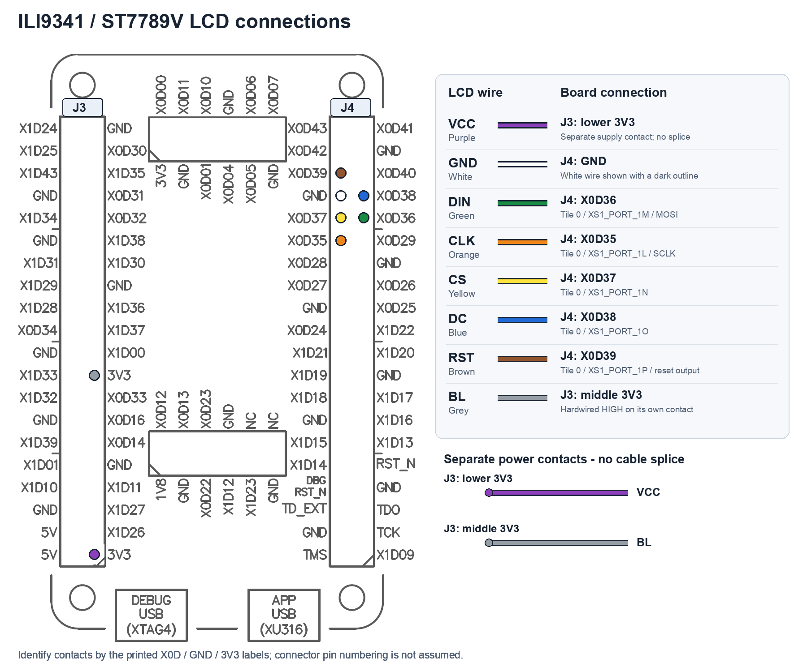

##########################
lib_xuh: USB host library
##########################

************
Introduction
************

``lib_xuh`` is a USB host library for XMOS XS2 and XS3 devices. It provides three
layers:

* the USB host transport: the host controller task and single-packet transfers
  (``xuh.h``);
* the host core, which waits for a device, enumerates it and describes its
  interfaces and endpoints to the application (``xuh_host.h``);
* a read-only mass storage class driver (``xuh_msc.h``), with optional FatFs
  disk functions.

The library is experimental. Its limits are listed in the "Known issues" section
of ``README.rst``.

*****
Usage
*****

``lib_xuh`` is used with `XCommon CMake <https://www.xmos.com/file/xcommon-cmake-documentation/?version=latest>`_.
Include it in the application's ``APP_DEPENDENT_MODULES``:

.. code-block:: cmake

    set(APP_DEPENDENT_MODULES "lib_xuh")

Tasks
=====

The application runs the host controller, ``XUH_Manager()``, on its own logical
core on the USB tile, and a host task of its own on the same tile. They are
connected by an array of channels in each direction. Slot 0 of each array is the
default control endpoint; the others are for class drivers.

.. code-block:: xc

    #define NUM_EPS 3

    int main()
    {
        chan c_out[NUM_EPS], c_in[NUM_EPS];
        par {
            on tile[1]: XUH_Manager(c_out, NUM_EPS, c_in, NUM_EPS);
            on tile[1]: UsbHost(c_out, NUM_EPS, c_in, NUM_EPS);
        }
        return 0;
    }

The USB tile is set with ``USB_TILE`` in the application's ``xud_conf.h``. The
host core and class driver functions are C functions. Call them from the one
host task: an endpoint handle is only valid on the tile of ``XUH_Manager()``.

Enumerating a device
====================

The host task owns an ``XUH_Host`` and decides what to do with the device that
is found:

.. code-block:: c

    void UsbHost(chanend c_out[], unsigned n_out, chanend c_in[], unsigned n_in)
    {
        XUH_Host host;
        XUH_Device device;
        XUH_Msc msc;

        XUH_Host_Init(&host, c_out[0], c_in[0], &c_out[1], n_out - 1, &c_in[1], n_in - 1);
        if (XUH_Host_WaitForDevice(&host, &device) == XUH_OK) {
            if (XUH_Msc_Open(&msc, &host, &device) == XUH_OK) {
                /* Mass storage: FatFs drive 0. f_mount(), f_open() ... */
            }
        }
    }

``XUH_Host_WaitForDevice()`` blocks until a device is attached. It then reads
the device and configuration descriptors, gives the device an address, selects
its first configuration and returns its identifiers and every interface and
endpoint in an ``XUH_Device``. It does not interpret the device class.

One device is enumerated, after reset: a second call returns
``XUH_ERR_UNSUPPORTED``.

Every call returns an ``XUH_Status``. The codes for timeouts, stalls and
disconnection are reserved until the transport can report them; until then a
transfer to a device that stops responding blocks.

An application that handles a device class itself can find an interface with
``XUH_Device_FindInterface()``, bind channel slots to its endpoints with
``XUH_Host_ClaimEndpoint()`` and use the transfers in ``xuh.h``, and
``XUH_Host_ControlIn()`` and ``XUH_Host_ControlNoData()`` for control requests.

Mass storage
============

``XUH_Msc_Open()`` returns ``XUH_ERR_UNSUPPORTED`` for a device that is not mass
storage, so it is also the test for one. On success ``blockCount`` and
``blockSize`` of the ``XUH_Msc`` give the capacity, and ``XUH_Msc_Read()`` reads
blocks.

The driver is read only, uses logical unit 0 and requires 512-byte blocks.

FatFs
=====

To use FatFs, set ``XUH_MSC_FATFS`` to 1 in an application ``xuh_conf.h`` and add
``lib_fatfs`` to the application's dependencies:

.. code-block:: c

    #define XUH_MSC_FATFS 1

``lib_xuh`` then provides the FatFs disk functions, and ``get_fattime()``, for
the device most recently opened with ``XUH_Msc_Open()``, which is physical drive
0. ``lib_xuh`` does not depend on, or call, FatFs: the application mounts and
uses the volume.

.. code-block:: c

    static FATFS fs;

    if (XUH_Msc_Open(&msc, &host, &device) == XUH_OK) {
        f_mount(&fs, "", 1);
        /* f_open(), f_read() ... */
    }

Activity callback
=================

The library reports what it is doing on the bus to a callback registered with
``XUH_Host_SetActivityCallback()``, for example to drive an activity LED. Each
activity (``XUH_ACTIVITY_ENUMERATE``, ``XUH_ACTIVITY_MSC_OPEN``,
``XUH_ACTIVITY_MSC_READ``) is followed by ``XUH_ACTIVITY_IDLE`` or
``XUH_ACTIVITY_ERROR`` when it ends.

.. code-block:: c

    XUH_ACTIVITY_CALLBACK static void usb_activity(XUH_Activity activity)
    {
        /* ... */
    }

    XUH_Host_SetActivityCallback(&host, usb_activity);

The callback runs in the host task and must not call back into the library.
``XUH_ACTIVITY_CALLBACK`` lets the tools account for its stack.

Configuration
=============

Options and their defaults are in ``xuh_config.h``. Override them in an optional
application ``xuh_conf.h``.

.. list-table::
   :header-rows: 1
   :widths: 40 10 50

   * - Option
     - Default
     - Purpose
   * - ``XUH_MAX_INTERFACES``
     - 4
     - Interface descriptors recorded for a device
   * - ``XUH_MAX_ENDPOINTS_PER_INTERFACE``
     - 4
     - Endpoint descriptors recorded for an interface
   * - ``XUH_MAX_DATA_EPS``
     - 3
     - Non-control channel slots in each direction
   * - ``XUH_CONFIG_DESC_MAX``
     - 512
     - Largest configuration descriptor, in bytes
   * - ``XUH_DEVICE_ADDRESS``
     - 3
     - Address given to the device
   * - ``XUH_MSC_FATFS``
     - 0
     - Provide the FatFs disk functions
   * - ``XUH_MSC_TRACE``
     - 0
     - Print each mass storage command

********
Examples
********

The examples are for XK-EVK-XU316 with VBUS hardwired, and expect a high-speed
USB mass storage device with a FAT volume. They use the XU316-only transport;
the library's XS2 transport support is separate.

app_xuh_msc
===========

``examples/app_xuh_msc`` is a complete, minimal application of the calls above.
It prints the description of the attached device, mounts a mass storage volume
with FatFs, lists the root directory and prints the first ``.TXT`` file in it.

In a terminal with the XMOS XTC tools available, from the repository root::

    cmake -G "Unix Makefiles" -S examples/app_xuh_msc -B build-msc
    xmake -C build-msc
    xrun --xscope examples/app_xuh_msc/bin/app_xuh_msc.xe

The output has this form::

    Waiting for a USB device
    USB device abcd:1234, class 0x00, 1 interface(s)
      Interface 0: class 0x08 subclass 0x06 protocol 0x50
        Endpoint 0x01: attributes 0x02, max packet 512
        Endpoint 0x81: attributes 0x02, max packet 512
    Mass storage: 247808 blocks of 512 bytes
    Root directory:
      TEST.TXT      27 bytes
      VIDEO.M1V     13570971 bytes
    TEST.TXT:
    ...
    Done

app_xuh_player
==============

``examples/app_xuh_player`` plays video from a FAT-formatted USB stick to a
320 x 240 SPI LCD on XK-EVK-XU316-AIV. Source and test paths in this section are
relative to that directory unless they start at the repository root.

Playback loops at maximum speed; it does not pace frames, intentionally skip
pictures or synchronise audio and video. Successful plays drain all outstanding
display work before reopening the file. File and decoder errors stop playback
after pending valid work drains.

Build and run
-------------

In terminal with XMOS XTC tools available. From the repository root::

    cmake -G "Unix Makefiles" -S examples/app_xuh_player -B build-video
    xmake -C build-video

The XU316/LCD build provides three configurations:

.. list-table:: Player configurations
   :header-rows: 1

   * - Configuration
     - USB root file
     - Behaviour
   * - ``jpeg``
     - ``VIDEO.MJP``
     - Raw baseline MJPEG video
   * - ``mpeg1``
     - ``VIDEO.M1V``
     - MPEG-1 elementary video, I/P/B pictures
   * - ``mpeg1_audio``
     - ``VIDEO_320x180.MPG``
     - MPEG-1 program-stream video; decode and discard MP2 audio

Each executable contains only its selected video decoder. Build one
configuration with ``xmake -C build-video mpeg1`` and run it with::

    xrun --xscope --xscope-io-only build-video/bin/mpeg1/app_xuh_player_mpeg1.xe

Substitute the configuration in both path components for another player.
Successful playback runs indefinitely; stop xrun with Ctrl-C after collecting
completed-play reports. Use xSCOPE, not JTAG ``--io`` logging: JTAG can halt the
timing-sensitive USB task. Running these images loads RAM only; it does not
program flash or modify the USB stick.

The example requires an XK-EVK-XU316 target and defaults to the AIV carrier
configuration. VBUS is assumed to be hardwired; there is no board USB-switch GPIO
task. The library's transport code can still support other device families.

Dependencies are declared in ``examples/deps.cmake``. XCommon fetches missing
repositories but does not update existing sibling checkouts.

Configuration
-------------

Pass these options to CMake, preferably using a separate build directory for each
benchmark configuration:

.. list-table:: Application options
   :header-rows: 1

   * - Option
     - Default
     - Purpose
   * - ``APP_XUH_PLAYER_LCD_CONTROLLER``
     - ``ILI9341``
     - Select ``ILI9341`` or ``ST7789V``
   * - ``APP_XUH_PLAYER_LCD_TEST_MODE``
     - ``OFF``
     - Run a moving-box LCD test instead of video
   * - ``APP_XUH_PLAYER_FPS_OVERLAY``
     - ``ON``
     - Draw a smoothed measured-FPS gauge with the MPEG source-rate target
   * - ``APP_XUH_PLAYER_ACTIVITY_LED``
     - ``ON`` on AIV
     - Enable the activity/status LED task
   * - ``APP_XUH_PLAYER_LED_ACTIVE_LOW``
     - ``OFF``
     - Invert LED outputs for active-low wiring
   * - ``APP_XUH_PLAYER_AUDIO_DECODE``
     - ``ON``
     - In ``mpeg1_audio``, decode MP2; ``OFF`` measures demux/I/O only
   * - ``APP_XUH_PLAYER_AUDIO_METER``
     - ``ON``
     - In ``mpeg1_audio``, draw a stereo level meter for the decoded audio
   * - ``APP_XUH_PLAYER_MPEG_FILE``
     - Empty
     - Override the MPEG root filename; the defaults remain configuration-specific
   * - ``APP_XUH_PLAYER_FRAME_TIMING``
     - ``OFF``
     - Collect MPEG decode and service-period histograms
   * - ``APP_XUH_PLAYER_PROFILE_SILENT``
     - ``OFF``
     - Disable xSCOPE and discard terminal output for sampled profiling

``lib_mpeg`` uses the XS3 VPU inverse DCT and RGB565 converter by default.
Library options are set in an application ``mpeg_conf.h``, for example
``#define MPEG_VIDEO_IDCT MPEG_VIDEO_IDCT_PLMPEG`` for the original transform or
``#define MPEG_RGB565_VPU 0`` for scalar colour conversion. They are not CMake
cache options. See the ``lib_mpeg`` guide
for arithmetic/accuracy differences and the MP2 options.

The ``mpeg1_audio`` default is a 320 x 180 program stream. To play another
program stream on the USB stick, such as the full-screen ``VIDEO.MPG``, select
its filename without renaming the file::

    cmake -G "Unix Makefiles" -S examples/app_xuh_player -B build-full-video \
      -DAPP_XUH_PLAYER_MPEG_FILE=VIDEO.MPG
    xmake -C build-full-video app_xuh_player_mpeg1_audio
    xrun --xscope --xscope-io-only \
      build-full-video/bin/mpeg1_audio/app_xuh_player_mpeg1_audio.xe

The filename selects the input, not its dimensions or format. The ``mpeg1``
configuration still requires elementary video; ``mpeg1_audio`` demultiplexes MPG.
The application's FatFs configuration enables long filenames with a static
workspace owned by its single filesystem task.

LCD connection
--------------

Both supported controllers are 240 x 320 panels used in 320 x 240 landscape.
The controller is selected at build time, not detected from hardware. MISO is
unused; connect the LCD and XU316 grounds together.

.. list-table:: Tile-0 LCD pins
   :header-rows: 1

   * - Signal
     - xcore port
     - Device pin
   * - SCLK
     - ``XS1_PORT_1L``
     - ``X0D35``
   * - MOSI
     - ``XS1_PORT_1M``
     - ``X0D36``
   * - CS
     - ``XS1_PORT_1N``
     - ``X0D37``
   * - DC
     - ``XS1_PORT_1O``
     - ``X0D38``
   * - RST
     - ``XS1_PORT_1P``
     - ``X0D39``

   LCD wiring on the XK-EVK-XU316-AIV headers

SPI uses mode 0 at 50 MHz, set by ``LCD_SPI_KHZ`` in ``src/lcd_display.xc``.
The complete RGB565 framebuffer is assembled before a transaction starts, and
chip select remains asserted from address-window commands through all pixels.
ILI9341 uses MADCTL 0x28 with inversion off; ST7789V uses MADCTL 0x60 with inversion
on. Verify orientation, colour order and signal integrity on the actual panel.
The 50-MHz throughput measurement below applies to ILI9341; ST7789V has not been
validated at that clock. Consult the carrier schematic for physical connectors.

With ``APP_XUH_PLAYER_LCD_TEST_MODE=ON`` a 32 by 32 box moves across the display
in place of video. Each animation step updates only the 33 by 32 region covering
the old and new box positions.

Input files
-----------

MJPEG requires concatenated baseline JPEG frames, normally 320 x 240, with a
maximum compressed frame size of 30 KiB. Smaller pictures are centred with black
borders. The buffered reader validates JPEG segment lengths, entropy stuffing,
restart markers, truncation and buffer limits, including split disk-read
boundaries. Raw MJPEG carries no presentation timestamps; AVI is unsupported.

MPEG video must be fixed-resolution, progressive MPEG-1 YUV420, no larger than
320 x 240, with width divisible by eight and even height. Dimensions are read
from the stream, not inferred from its filename. Smaller pictures are centred
without scaling: 320 x 180 starts at screen coordinate (0, 30). The
elementary-stream player accepts I, P and B pictures, not an MPG/AVI container.
A compressed picture plus decoder lookahead must fit the 32-KiB input buffer;
reduce quality or bitrate if an encode exceeds that bound.

RGB slots retain the screen stride and capacity. Each slot's black borders are
cleared when its picture dimensions change; only the centred picture rectangle
is transmitted each frame. The physical LCD is cleared when dimensions change
to remove a previous larger picture. The FPS gauge always occupies the same
screen rectangle, (4, 4) through (107, 25), regardless of video size. Small text
sits above a 96-pixel-wide bar, with four black rows before a centred
320 x 180 picture. If the
picture does not cover the gauge, its fixed rectangle is refreshed separately;
black borders do not otherwise consume recurring transfer bandwidth.

In ``mpeg1_audio`` a stereo level meter mirrors the gauge in the top-right
corner, in the fixed rectangle (212, 4) through (315, 25), refreshed in the same
way. Its left and right bars grow from the right-hand edge towards the centre of
the screen on a 48-dB logarithmic scale, 11 pixels for each halving of the peak
level: green when quiet, through amber, to red at full scale. Each bar rises
at once, falls two pixels a frame and carries a white peak-hold tick. The audio
task publishes the peak of each decoded MP2 block to the display task, on the
same tile, without a channel. The audio is still neither played nor synchronised
with the video: the meter shows the level of the audio most recently decoded.

For MPEG, the white tick marks the nominal frame rate read from the stream's
sequence header, rounded to tenths for display positioning. The bar's colour
gradient reaches green at that target; the numeric reading and filled length
remain measured playback throughput. The scale is 0--40 FPS for sources up to
40 FPS and expands for 50/60-FPS sources to keep the tick visible. MJPEG has no
sequence-header rate and retains a 25-FPS reference. Position and size are
independent of the target rate.

The program-stream player supports MPEG-1 pack/PES headers, video stream 0xe0
and MP2 audio stream 0xc0. It skips other packet types and rejects MPEG-2 pack
headers. Timestamps are not used. MP2 PCM is decoded on tile 0 and discarded;
there is no physical audio output or A/V synchronisation.

Audio crosses tiles in chunks of at most 1024 bytes. Each chunk is acknowledged
after consumption, including bypass and latched-error paths, before the producer
sends another. Stop returns accumulated statistics and closes the decoder so the
same worker can service the next play.

Example encodes with FFmpeg::

    ffmpeg -i source.mp4 -t 30 -an \
      -vf "fps=25,scale=320:240,setsar=1" \
      -c:v mpeg1video -pix_fmt yuv420p -g 12 -bf 2 -q:v 6 \
      -f mpeg1video VIDEO.M1V
    ffmpeg -i source.mp4 -t 30 \
      -vf "fps=25,scale=320:240,setsar=1" \
      -c:v mpeg1video -pix_fmt yuv420p -g 12 -bf 2 -q:v 6 \
      -c:a mp2 -ar 48000 -ac 2 -b:a 192k -f mpeg VIDEO.MPG
    ffmpeg -i source.mp4 -t 30 -an \
      -vf "fps=10,scale=320:240,setsar=1" \
      -c:v mjpeg -pix_fmt yuvj420p -q:v 5 -f mjpeg VIDEO.MJP

These commands stretch the complete picture without cropping. The application's
``makempeg1.sh`` and ``makemjpg.sh`` contain source-specific demo edits; their
input media are not distributed. Copy the output to the USB stick yourself:
the player does not read the host-side ``data/`` directory.

Pipeline and ownership
----------------------

Tile 1 owns the USB manager, FatFs/read-ahead loader and video decoder. Tile 0
owns the pixel receiver/converter, LCD renderer and SPI master. The optional MP2
decoder also runs on tile 0; the activity LED runs on tile 1.

``src/video_loader.c`` provides the shared, storage-independent loader. A source
returns either one complete JPEG frame or an MPEG chunk of at most 4096 bytes.
It fills an alternate input slot while the decoder consumes the current one.
Ready messages carry slot/sequence/size; acknowledgements explicitly release
ownership and apply bounded backpressure. Stop/error messages drain pending
work, and workers remain alive between plays.

For MJPEG, tile 1 has two 30-KiB compressed slots and one 230400-byte RGB888
buffer. Decode and RGB transmission do not overlap; file loading and LCD output
can overlap decoding. Tile 0 converts received pixels into two 153600-byte
RGB565 framebuffers, allowing receive/conversion to overlap rendering.

For MPEG, tile 1 has two 4096-byte loader slots and a 384-KiB decoder arena.
The decoder/transmitter sends each picture as two-row YUV420 strips using the
library plane strides. Tile 0 converts a 960-byte strip directly into one of its
two RGB565 framebuffers; no full RGB888 or extra YUV framebuffer is allocated.
Once conversion, overlay and optional hashing finish, tile 0 acknowledges YUV
ownership before waiting for the previous LCD render. The next send backpressures
until a safe RGB slot is available. Frame zero waits for the first LCD completion;
EOF drains the final render before statistics return.

Pointers remain on their owning tile; pixel bytes cross tiles. Channel messages
end with CT_END, and ownership handoffs include compiler memory barriers.
The decoder may reuse YUV planes only after acknowledgement, and RGB slots may
be reused only after rendering completes. Multi-sector READ(10) commands serve
FatFs reads, with at most 64 512-byte sectors per command. Display work and
filesystem reads do not execute inside the USB manager.

The large memory model is required. A default MPEG-1 build uses 332516 bytes on
tile 0 and 482692 bytes on tile 1, including code, data and reserved stacks;
41596 bytes remain on tile 1. These are build-dependent figures, not an SRAM
budget for arbitrary additions. The decoder's 16-KiB stack reservation is
provisional because callback branches prevent complete automatic analysis.

Activity/status LED
-------------------

On the example hardware, tile-1 port 32A bits 0 and 1 drive active-high green and red LEDs.
Idle is dim green breathing; storage operations pulse green, decoding adds red,
and completed frames trigger rate-limited red accents. Reported errors latch a
double-red-flash pattern until reset. A blocked USB operation remains busy:
the LED is not a transfer timeout or watchdog.

The effect uses one thread and hardware timer. Producers publish tile-local
mailbox words without channel handshakes in the playback path. Do not share port
32A ownership with another task. Disable the LED for a comparison only if it is
disabled in every compared build.

Metrics and performance
-----------------------

The completed-play report counts a frame only after its LCD transaction finishes.
It includes frame/error counts, decoder status, bytes read, arena peak/cleanup,
startup latency, FPS and per-stage means. There is no routine per-frame logging.
Unsigned reference-timer deltas accumulate into a 64-bit play total; each
individual interval must fit one 32-bit timer period (42.9 s at 100 MHz).

Benchmark with a full-screen 320 x 240 picture. The ``mpeg1`` default is one;
the ``mpeg1_audio`` default is the smaller 320 x 180 stream, so configure that
build with ``-DAPP_XUH_PLAYER_MPEG_FILE=VIDEO.MPG`` when measuring.

.. list-table:: Default MPEG-1 hardware workload
   :header-rows: 1

   * - Setting
     - Value
   * - Target/toolchain
     - XU316 at 600 MHz, XTC Tools 15.3.1
   * - Display
     - ILI9341, 320 x 240 RGB565, 50-MHz SPI
   * - Input
     - 3025 pictures at 25 FPS; GOP 12, two B pictures, qscale 6
   * - Input size
     - 13570971 bytes
   * - Enabled features
     - VPU IDCT/conversion, read-ahead, multi-sector reads, FPS overlay, LED
   * - Audio / timing histograms
     - Disabled
   * - Completed-play rate
     - **33.59 FPS** (90.049 s per play)
   * - Startup to first completed frame
     - 77.003 ms

.. list-table:: Stage means for that workload (ms per displayed frame)
   :header-rows: 1

   * - Stage
     - Tile
     - Time
   * - Load
     - 1
     - 1.884
   * - Wait for loader
     - 1
     - 0.500
   * - Feed
     - 1
     - 0.097
   * - Decode
     - 1
     - 19.137
   * - Transmit / acknowledgement wait
     - 1 to 0
     - 10.014
   * - Receive YUV / wait
     - 0
     - 1.310
   * - YUV to RGB565
     - 0
     - 5.766
   * - Wait previous LCD
     - 0
     - 6.318
   * - LCD SPI
     - 0
     - 25.471

Wait/feed/decode/handoff run serially on the decoder task and occupy about
29.7 ms/frame. Loading, receive/conversion and LCD output overlap other stages;
do not add them as independent costs. Send time includes blocked channel output
while tile 0 converts or waits for a buffer; it is not pure link bandwidth.
The 25.471-ms LCD transaction gives an approximately 39.3-FPS display ceiling,
but the whole player is not at that ceiling.

These figures describe one clip, not a worst-case or guaranteed 30-FPS rate.
For a separate 320 x 180 re-encode of the reference clip, centred at (0, 30),
the ``mpeg1_audio`` player completes 3026 displayed pictures in 74.941 seconds
(40.37 FPS), with mean video decode time 15.463 ms and LCD-transfer time
20.341 ms per frame. That run has MP2 decode/discard enabled (5042 blocks),
the FPS gauge fixed at (4, 4), and no timing histograms. Both complete plays
report zero errors and zero live video-arena bytes after close. This is a
different encoded workload/configuration, not a matched decoder-speed comparison.

Optional instrumented runs report decode and decoder service-period
percentiles, maxima and counts above 40 ms for the current build/input.
Service intervals mark successive YUV handoffs, not LCD scanout; they are not
a count of missed presentation deadlines in paced playback.

Frame timing is enabled with ``-DAPP_XUH_PLAYER_FRAME_TIMING=ON``. It uses two
bounded histograms with 1-ms percentile upper bounds through 126 ms and an
overflow bucket bounded by the observed maximum. Decode samples sum all
``mpeg_next()`` work needed for a picture; service samples include input, feed,
decode and handoff/backpressure, excluding startup. Summaries print only after
rendering drains. Instrumentation can affect scheduling and should remain off
for headline throughput measurements.

Validation
----------

Application-owned PS-reader, MJPEG-reader, activity-LED, FPS-overlay and
frame-timing tests run natively, with ASan, UBSan and assertions enabled. The
suite also checks the profile parser and compares demultiplexed video/audio
bytes against FFmpeg for generated I/P, I/P/B and video-only program streams.
FFmpeg and a sibling ``lib_fatfs`` checkout (including its FatFs submodule) are
required; set ``FATFS_ROOT`` if that checkout is elsewhere::

    python3 -m venv .venv
    source .venv/bin/activate
    cmake -S examples/app_xuh_player/tests -B build-app-native-tests
    cmake --build build-app-native-tests -j 8
    ctest --test-dir build-app-native-tests --output-on-failure

To include a local full program stream in the byte-identity check::

    python examples/app_xuh_player/tests/test_ps_demux.py \
      --demux build-app-native-tests/mpeg_ps_demux \
      --work build-app-native-tests/ps-full \
      --full examples/app_xuh_player/data/VIDEO.MPG

``VIDEO.MPG`` is generated locally and excluded from Git; use the input-file
commands above to make your own. The demux checks belong to this application
and do not build or depend on the MPEG decoder.

The finite ``tests/app_audio_pipeline`` fixture runs the actual MP2 channel task
on tile 0 with a tile-1 producer. Eight cases cover partial-word and multi-chunk
sends, deterministic replay, decode bypass, empty/truncated/malformed input,
draining after a latched error and restart. The runner generates three MP2
frames with FFmpeg and requires normal termination and the checked success
marker::

    cmake -G "Unix Makefiles" -S examples/app_xuh_player/tests/app_audio_pipeline \
      -B build-audio-pipeline
    xmake -C build-audio-pipeline -j 8
    python examples/app_xuh_player/tests/run_audio_pipeline.py \
      --xe build-audio-pipeline/bin/test_audio_pipeline.xe \
      --work build-audio-pipeline/fixtures --adapter-id SERIAL --timeout 60

Omit ``--adapter-id`` to simulate with cycle and host-time bounds. This fixture
uses JTAG host-file I/O, not USB or a physical audio interface, and is not a
throughput benchmark.

MPEG decoder accuracy, MP2 arithmetic/PCM reference checks and player benchmark
runners belong to ``lib_mpeg``. With that library's Python venv
active, run its native validation suite from this repository's root::

    cmake -S ../lib_mpeg/tests -B ../lib_mpeg/build-native-validation \
      -DMPEG_TEST_VIDEO_STREAM="$PWD/examples/app_xuh_player/data/VIDEO.M1V"
    cmake --build ../lib_mpeg/build-native-validation -j 8
    ctest --test-dir ../lib_mpeg/build-native-validation --output-on-failure

Omit the reference-file option for generated fixtures only. The suite checks
video against pristine PL_MPEG and FFmpeg, elementary MP2 PCM precision and
replay, and completed-report parsing. It has no dependency on this application.
An optional full MP2 elementary file can be supplied with ``MPEG_TEST_AUDIO_STREAM``;
program streams must first be demultiplexed outside the codec tests.
The default transform changes rounding: it is not byte-identical to the original
PL_MPEG transform. On the full reference clip, Y/Cb/Cr PSNR against FFmpeg is
55.59/62.00/63.63 dB with maximum sample errors 5/3/3. See the library guide for
the numerical contract and standalone target tests.

For a matched hardware IDCT comparison, build the application once with
``MPEG_VIDEO_IDCT_PLMPEG`` selected in ``mpeg_conf.h`` and once with the default
VPU transform, keeping separate build directories, then run::

    python ../lib_mpeg/tests/usb_lcd/compare_mpeg_idct.py \
      --original build-original/bin/mpeg1/app_xuh_player_mpeg1.xe \
      --vpu build-vpu/bin/mpeg1/app_xuh_player_mpeg1.xe \
      --adapter-id SERIAL --stream examples/app_xuh_player/data/VIDEO.M1V \
      --work build-player-comparison --timeout 420

It checks complete reports, frame/byte counts, EOF status and arena cleanup,
preserves raw logs and executable/input hashes, and compares plays after startup.
The local input hash is recorded; the on-device file is checked by byte count,
not by a cryptographic hash. Both builds must use the same source state and
settings apart from the selected IDCT. Add ``--timing`` when both builds enable
the histograms. For the audio-enabled player's bounded hardware smoke check, use
``lib_mpeg/tests/usb_lcd/run_hardware.py --help``.

The finite ``tests/app_mpeg_pipeline`` fixture exercises the actual decoder,
cross-tile transfer and receiver with host-file input and a checksum renderer.
It validates native-model RGB565 hashes including black borders, resolution
changes between plays, delayed-renderer ownership, repeat/EOF drain and
open/read/empty-input recovery. It does not model USB or physical SPI.
Generated elementary fixtures include an explicit MPEG sequence-end marker:
the current decoder can leave final B-picture macroblocks unwritten on some
unterminated elementary streams. These fixtures do not validate that codec case.
With XTC Tools active, build a host reference first, then the six-picture fixture::

    cmake -S ../lib_mpeg/tests -B ../lib_mpeg/build-pipeline-reference
    cmake --build ../lib_mpeg/build-pipeline-reference -j 8
    cmake -G "Unix Makefiles" -S examples/app_xuh_player/tests/app_mpeg_pipeline \
      -B build-mpeg-pipeline -DMPEG_PIPELINE_TEST_FRAMES=6 \
      -DMPEG_PIPELINE_TEST_XSCOPE=OFF
    xmake -C build-mpeg-pipeline -j 8
    python examples/app_xuh_player/tests/run_mpeg_pipeline.py \
      --bench ../lib_mpeg/build-pipeline-reference/mpeg_bench \
      --xe build-mpeg-pipeline/bin/test_mpeg_pipeline.xe \
      --work build-mpeg-pipeline/fixtures --frames 6 --timeout 180 \
      --adapter-id SERIAL --jtag

Success requires normal termination, seven completed cases and all expected
frame hashes. Add ``--width 320 --height 180`` (or ``--width 256 --height 144``)
to test centred input; the second play uses an alternate resolution and the
remaining successful plays return to the requested size. The native window
test checks geometry, black borders, screen stride and the fixed gauge position.
Timeouts/cycle bounds are failures, not passes. JTAG is suitable
only for this substituted functional fixture, not the real USB player. The stock
simulator target uses xSCOPE on XL0 while AIV uses XL1; the JTAG fixture avoids
that wiring mismatch. Omit hardware options to use the simulator with a suitable
host timeout; simulation is much slower than hardware.

The native JPEG-reader and activity-LED tests are registered in the native suite
above. Their simulated or host results do not validate physical USB, LCD signal
integrity or LED polarity.
``PIPELINE_VERIFY=1`` enables development-only frame-integrity hashes; leave it
disabled for throughput measurements and disable the FPS overlay and the audio
meter when comparing unmodified frame hashes.

Sampled profiling
-----------------

XTC Tools 15.3.1 cannot combine ``--gprof`` with ``--xscope``. Build separately
with ``-DAPP_XUH_PLAYER_PROFILE_SILENT=ON`` for PC sampling; this discards writes
without JTAG logging pauses. Keep optimisation settings unchanged, run xgdb with
``connect --gprof`` and ``load``, break at ``video_loader_report``, then continue.
Inspect the completed play and quit to flush profiles. Extract the matching
ELFs with ``xobjdump -s`` and identify the decoder core by its PL_MPEG symbols.
Use the normal xSCOPE build for FPS and stage measurements, not the sampled run.

``tests/summarize_mpeg_profile.py`` maps full-width PC counters into matching ELF
function ranges; its parser tests are ``tests/test_profile_summary.py``.
PC sample shares include blocked instructions and are statistical hotspot
indicators, not exact call times or counts. Re-profile the current decoder before
selecting an optimisation target.

Limitations
-----------

* Playback has no pacing, seeking, arbitrary resolution changes, audio output or
  A/V synchronisation. The FPS overlay is a smoothed staging rate, not a deadline
  monitor. The audio meter shows decoded level, not something that is heard.
* USB support is experimental. Transfers can block indefinitely; disconnect,
  timeout/recovery and general device compatibility are incomplete.
* MPEG input is trusted, not hardened against arbitrary malformed media.
* Decoder stack reservations require production analysis. Check link-time SRAM
  reports when changing features, buffers or dependencies.
* Hardware throughput and LCD-clock validation apply to the measured board,
  panel and clip, not every USB stick, encode or LCD module.
